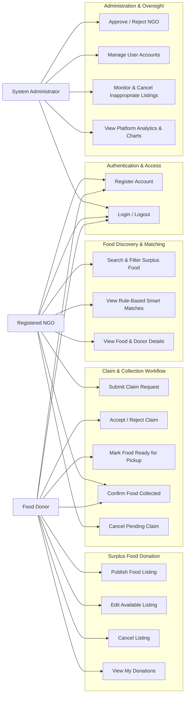
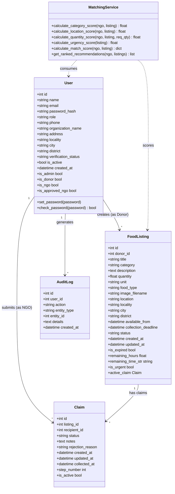
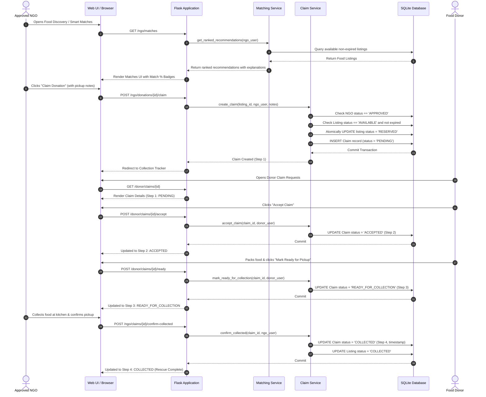
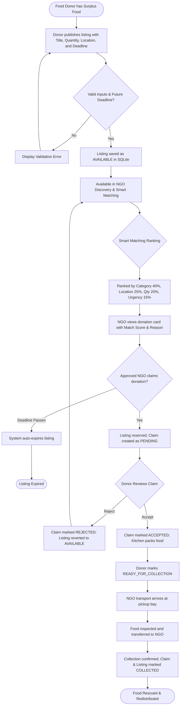
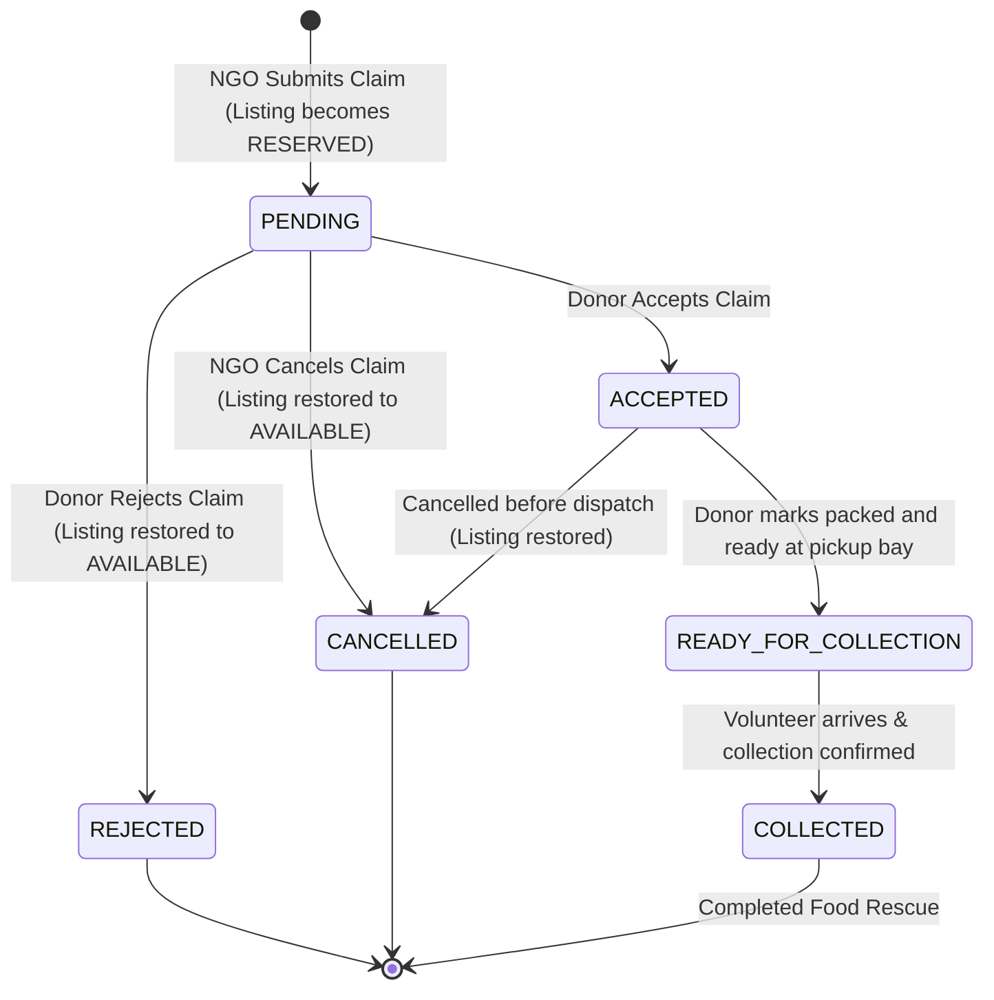
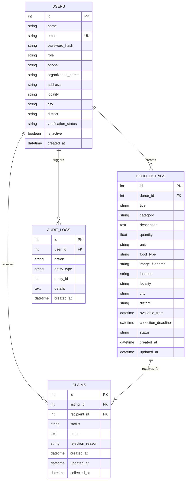

# SECOND SERVE: SYSTEM ARCHITECTURE & UML SPECIFICATIONS

This document outlines the software engineering and system design specifications for **Second Serve**, a Smart Food Waste Rescue and NGO Redistribution Management System.

---

## 1. Use Case Diagram

---

## 2. Class Diagram

---

## 3. Sequence Diagram: Claiming & Collection Lifecycle

---

## 4. Activity Diagram: Food Donation & Collection Lifecycle

---

## 5. State Machine Diagram: Claim Lifecycle

---

## 6. Entity-Relationship (ER) Diagram

